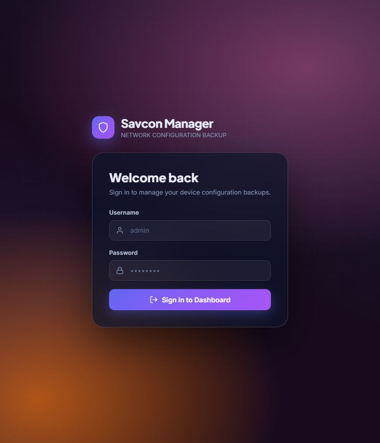
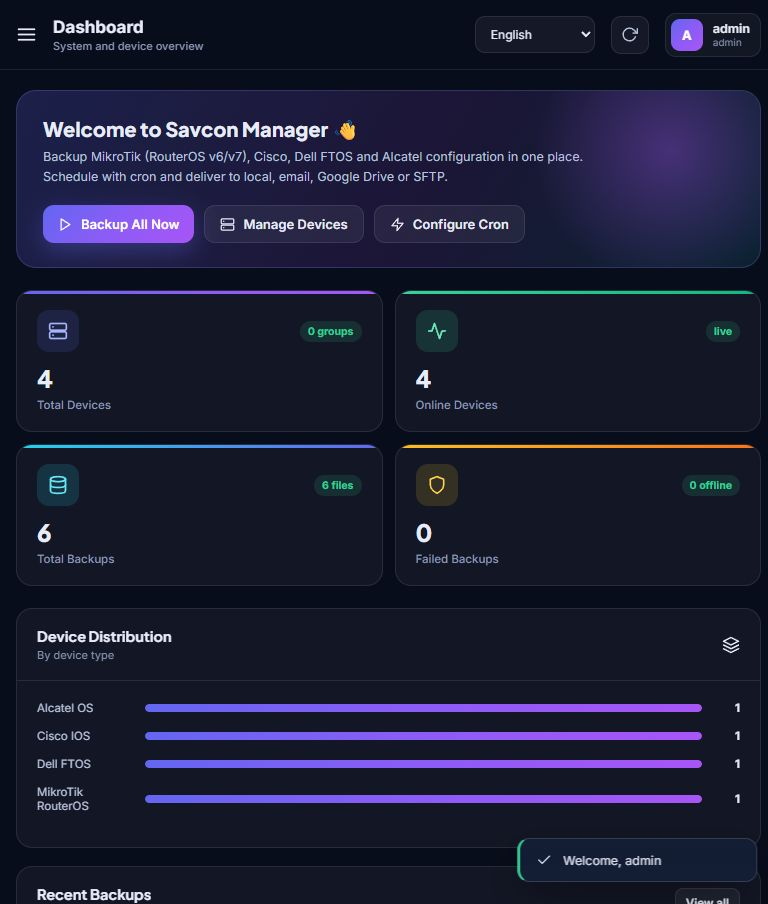
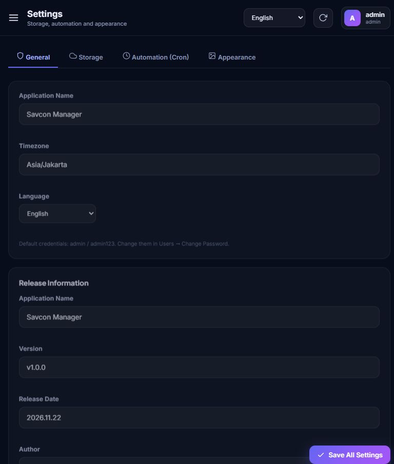

# 🛡️ Savcon Manager

> 🚀 A modern, self-hosted **network configuration backup manager** for routers and switches.
> One dashboard to back up MikroTik, Cisco, Dell FTOS and Alcatel devices — automatically, on a schedule, and straight to your favorite storage.


**Release:** `v1.0.1` · **Released:** 2026-11-23 · **Author:** [Nanda Anubis](https://github.com/nandaanubis)

---

## ✨ Features

- 🔄 **Automated backups** with cron scheduling (APScheduler) plus a one-click manual backup
- 🔐 **Multi-vendor support**
  - MikroTik RouterOS v6/v7 → `/export` (with optional `show-sensitive` for PPP secrets)
  - Cisco IOS / NX-OS, Dell FTOS, Alcatel OmniSwitch → `show running-config` / `show configuration snapshot`
- 🔌 **SSH & Telnet** with custom ports, usernames and passwords
- 🗂️ **Backup groups** — organize devices as *Mikrotik Core*, *Mikrotik Client*, etc.
- ♻️ **Configurable retention** (1–10 files per device, oldest files removed automatically)
- ☁️ **Flexible storage** — Local, Email (SMTP), Google Drive (service account) and SFTP (or all at once)
- 🖥️ **Modern Web UI** — dark glassmorphism design, responsive layout, smooth animations
- 🎨 **Customizable login background** — gradients or your own image, with adjustable opacity (0–100%)
- 👥 **User management** — add users, roles and change passwords
- 📊 **Device insights** — online/offline status, detected OS version and last backup timestamp
- 📜 **Activity log** — full audit trail of every action
- 🌍 **5 languages** — 🇮🇩 Indonesian · 🇬🇧 English · 🇪🇸 Español · 🇨🇳 中文 · 🇧🇷 Português

---

## 📸 Screenshots

| 🔐 Login | 📊 Dashboard |
|:---:|:---:|
|  |  |

| ⚙️ Settings |
|:---:|
|  |

> 💡 Modern dark glassmorphism UI — responsive, customizable login background, and a clean device overview.

---

## 🧩 Supported Devices

| Vendor | Protocol | Config command | Version detection |
|---|---|---|---|
| MikroTik RouterOS v6/v7 | SSH / Telnet | `/export` (`show-sensitive` optional) | `/system resource print` |
| Cisco IOS / NX-OS | SSH / Telnet | `show running-config` | `show version` or config header |
| Dell FTOS | SSH / Telnet | `show running-config` | `show version` |
| Alcatel OmniSwitch (AOS) | SSH / Telnet | `show configuration snapshot` | `show version` |

> 💡 Legacy Cisco/NX-OS boxes that only offer `ssh-rsa` host keys are supported via Paramiko 3.x.

---

## 🚀 Quick Start

```bash
# 1. Clone
git clone https://github.com/nandaanubis/savcon-manager.git
cd savcon-manager

# 2. (Optional) set secrets — .env is gitignored
cp .env.example .env

# 3. Run
docker compose up -d --build

# 4. Open
# http://<server-ip>:8111
```

🔑 Default login: **admin / admin123** — please change it after your first login.

---

## ⚙️ Configuration

All runtime settings are managed from the web UI (**Settings** menu):

| Tab | What you can configure |
|---|---|
| ⚙️ General | App info, language, release details |
| ☁️ Storage | SMTP, SFTP and Google Drive credentials + connection tests |
| ⏰ Automation | Cron expression, group filter, run-now |
| 🎨 Appearance | Login background (gradient/upload), card opacity |

Environment variables (all optional, defaults provided):

| Variable | Default |
|---|---|
| `SECRET_KEY` | `change-this-secret-in-production` |
| `DEFAULT_ADMIN_USER` | `admin` |
| `DEFAULT_ADMIN_PASSWORD` | `admin123` |
| `ACCESS_TOKEN_EXPIRE_HOURS` | `24` |
| `TZ` | `Asia/Jakarta` |

📁 Application data (SQLite database, backups, backgrounds) lives in `./data` and is **excluded from Git**.

---

## 🔒 Security Notes

- 🔑 `SECRET_KEY` is **auto-generated and persisted** to `data/secret.key` when left at its default, so a fresh install never ships with a forgeable JWT signing key.
- 👤 Non-admin users cannot read SMTP / SFTP / Google Drive credentials — `GET /api/settings` is redacted for them.
- 🖼️ Only `data/backgrounds` is served publicly (`/media/backgrounds`); the SQLite database and backup files are **not** web-accessible.
- 🚫 Background changes require admin authentication; login has basic brute-force throttling (5 attempts / 5 min per IP).
- ⚠️ **Known tradeoff:** Paramiko is pinned to `3.x` so legacy Cisco/NX-OS switches that only offer `ssh-rsa` host keys can still be backed up. This keeps [CVE-2026-44405](https://nvd.nist.gov/vuln/detail/CVE-2026-44405) (SHA-1 host key, CVSS low / adjacent-network) applicable. Upgrade those devices' SSH host keys to RSA-SHA2/Ed25519 before moving to Paramiko 5.x.

---

## ⏰ Cron Examples

| Expression | Meaning |
|---|---|
| `0 2 * * *` | Every day at 02:00 |
| `*/15 * * * *` | Every 15 minutes |
| `0 8,20 * * *` | At 08:00 and 20:00 |
| `0 0 * * 0` | Every Sunday |

---

## 🔗 API

Interactive Swagger docs: `http://<server-ip>:8111/docs`

Health check: `GET /api/health` · Release info: `GET /api/about`

---

## 🧱 Tech Stack

🐍 Python 3.11 · ⚡ FastAPI · 🗄️ SQLite · 🔐 Paramiko · ⏱️ APScheduler · 🐳 Docker · 🎨 Vanilla JS SPA

---

## 👤 Author

**Nanda Anubis** — [GitHub](https://github.com/nandaanubis)

> _"App ini dibuat secara gabut dan dilahirkan secara suka suka. Mungkin App ini anomaly tapi percaya lah ini berfungsi sebagai mana mestinya - Nanda Anubis & AI POWER"_

---

⭐ If this project is useful for you, give it a star!
